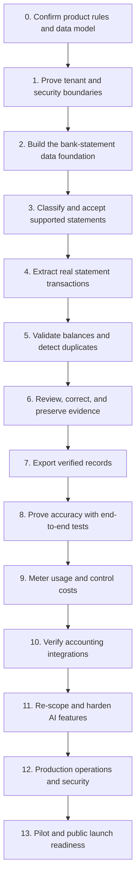

# Smart Financial Document Hub — Delivery Roadmap

## Purpose and authority

This is the delivery plan for work that remains after the source-code audit. It replaces earlier roadmap statements that called integrations, AI, monitoring, or other foundations “complete” without proving the full customer workflow.

The point-by-point source is [Analyses and recomended fix.md](./Analyses%20and%20recomended%20fix.md). Current fixes, evidence, and remaining gaps are recorded in [Audit Fixes and Remaining Work](./features/audit-remediation-2026-11.md).

**A feature foundation is not a finished customer feature.** “Complete” requires its backend, frontend, permissions, migrations, tests, documentation, and acceptance checks to work together.

## Current release decision

**Not ready for real customer financial data.**

### Milestone status

- **Milestone 0 — Scope defined:** The first users, workflow, accepted file types, transaction fields, review behavior, CSV-first export, and retention direction are documented in [00-mvp-product-scope.md](./features/00-mvp-product-scope.md). Bank names, exact layout versions, retention details, confidence thresholds, and accounting export order are intentionally deferred.
- **Next milestone — Milestone 1: Prove tenant boundaries and security foundations.** Implementation has not started. Wait for explicit approval before beginning it.

Local verification recorded so far:

- Backend: 180 passed, 1 skipped (the skipped test needs a live ClamAV service).
- Frontend: production build passed; 11 unit tests passed.
- PHP on this workstation is 8.3.14; the project requires PHP 8.4+. The supported PHP version still needs CI verification.
- Production services, PostgreSQL, provider sandboxes, backups/restoration, and deployment rollback have not all been verified.

Do not treat these local results as proof of production readiness.

## Milestone sequence

Milestones are ordered. Do not start a later milestone until the previous milestone passes its exit gate and the user approves continuing. Each milestone should be delivered as one small, reviewable feature with code, tests, documentation, and a recorded verification result.

### Milestone 0 — Confirm the first product workflow and rules

**Goal:** Agree what the first release must do before changing financial schemas or selecting a paid extraction provider.

**Work**

1. Select the first customer segment and a small set of bank statement formats.
2. Confirm the MVP path: upload, scan, identify supported statement, extract, validate, review/correct, export, and retain source evidence.
3. Define transaction values, supported currencies, rounding rules, duplicate behavior, required source references, and retention needs.
4. Decide whether the user selects “bank statement” or the application classifies it. For the first release, reject or clearly route unsupported document types.
5. Resolve the Constitution statement “Documents are temporary” against financial evidence and customer retention needs.
6. Confirm product positioning and the accounting output format for the pilot.

**Exit gate:** A reviewed, versioned MVP specification answers all six questions. No new extraction or financial-schema work begins before this gate.

**Audit coverage:** 5.1–5.4, 6.1, 7.1, 9.1, 9.4–9.5, 11–12, and the final product recommendation in section 14.

### Milestone 1 — Prove tenant boundaries and security foundations

**Goal:** Prove that one team cannot view or change another team’s information, including when a user belongs to multiple teams.

**Work**

1. Implement explicit active-team selection for multi-team users and use it consistently in UI, routes, policies, model scopes, and jobs.
2. Add positive and negative tests for page access, API/list results, downloads, search, exports, and queued jobs across two teams.
3. Verify team-specific roles and permissions remain isolated after switching teams.
4. Verify private storage paths and download authorization; document encryption-at-rest and backup expectations.
5. Review OAuth configuration and ensure missing production credentials fail clearly and safely.
6. Define privacy, retention, deletion, and provider data-sharing rules before sending customer information to external services.

**Exit gate:** Automated cross-team tests cover all existing sensitive paths, active-team tests pass, and a security reviewer accepts the storage and OAuth behavior.

**Audit coverage:** 3.7, 4.1–4.2, 9.1, and privacy/security items in sections 10–11.

### Milestone 2 — Build the bank-statement data foundation

**Goal:** Define a safe and traceable financial record before writing an extractor.

**Work**

1. Translate the approved MVP specification into statement and transaction fields.
2. Store debit, credit, running balance, currency, dates, and stable source location where needed.
3. Use decimal-safe database and backend operations; do not calculate money using JavaScript floating point.
4. Add safe, reversible migrations and team-scoped constraints/indexes supported by MySQL and PostgreSQL.
5. Link transactions to their document and extraction version so a reviewer can trace where each value came from.
6. Update models, policies, API contracts, frontend types, and developer documentation together.

**Exit gate:** Schema and API contract are reviewed; migration up/down tests and MySQL/PostgreSQL checks pass; financial values round-trip without precision loss.

**Audit coverage:** 3.5, 5.1–5.2, 5.4, 9.2.

### Milestone 3 — Classify and accept supported statements

**Goal:** Ensure the pipeline processes only supported financial documents.

**Work**

1. Add a document type/status workflow with explicit supported, unsupported, and needs-review outcomes.
2. Keep scanning before processing.
3. Route supported bank statements to the statement pipeline; do not run invoice, receipt, and contract extraction on every upload.
4. Explain unsupported formats in the UI and preserve a safe retry path.
5. Keep the existing fake extractors limited to clearly marked local/testing demonstrations.

**Exit gate:** Feature tests prove supported statements enter the correct job path, unsupported documents do not create fake financial records, and scan failures block processing.

**Audit coverage:** 3.3–3.4 and the current/target workflow in section 12.

### Milestone 4 — Extract real statement transactions

**Goal:** Replace simulated statement rows with real, provider-backed extraction for the approved formats.

**Work**

1. Select and document a real parser/OCR provider behind a replaceable service interface.
2. Configure credentials and provider selection without hard-coding secrets or locking the product to one vendor.
3. Normalize provider output into the approved statement and transaction schema.
4. Store provider/model/version and safe processing metadata, not unnecessary sensitive prompt or document content.
5. Handle timeouts, rate limits, retries, malformed responses, and provider outages explicitly.
6. Add fixtures based on consented or anonymized sample statements.

**Exit gate:** Real sample statements produce source-linked structured results; no demo values are represented as extracted customer data; failure and retry tests pass.

**Audit coverage:** 3.3–3.5, 9.3, and section 12 extraction steps.

### Milestone 5 — Validate balances and detect duplicates

**Goal:** Find errors before users export financial data.

**Work**

1. Check opening balance + credits - debits = closing balance using exact decimal rules.
2. Flag mismatch, missing fields, uncertain values, and unsupported currency rather than silently accepting them.
3. Detect duplicate statements and transactions using stable, documented keys.
4. Make reprocessing and queue retries idempotent.
5. Show validation results and clear next actions in the frontend.

**Exit gate:** Valid statements pass; invalid totals and duplicate fixtures are flagged; retry tests prove records are not duplicated.

**Audit coverage:** 5.2–5.3 and the duplicate/balance test cases in section 10.

### Milestone 6 — Review, correct, and preserve evidence

**Goal:** Let accountants correct uncertain values while retaining a clear record of what changed.

**Work**

1. Build a review screen that shows extracted rows and their source document/page/row.
2. Allow authorized users to correct values and mark records reviewed or approved.
3. Preserve original values and append correction history; never erase the evidence of a financial correction.
4. Record actor, time, reason, extraction version, and before/after values.
5. Add policies and tests preventing unauthorized or cross-team review.

**Exit gate:** Frontend review and correction works end to end; a correction can be traced to its source and actor; authorization and immutable-history tests pass.

**Audit coverage:** 4.3, 5.1, 5.3, and section 12 review/history steps.

### Milestone 7 — Export verified records

**Goal:** Provide usable files only after review/validation rules are met.

**Work**

1. Confirm export columns and Tally-ready format with pilot users.
2. Support CSV first; add Excel only if the approved MVP requires it.
3. Keep spreadsheet formula neutralization and safe file handling.
4. Store durable, team-scoped export-run records, status, filters, and output location; do not rely only on temporary cache.
5. Authorize every export and download and test tenant boundaries.

**Exit gate:** An approved transaction set exports with exact decimal values and correct columns; formula-injection, permissions, and cross-team download tests pass; export history survives cache clearing.

**Audit coverage:** 3.8, 4.4 export history, 10, and section 12 export step.

### Milestone 8 — Prove accuracy with end-to-end tests

**Goal:** Show that the complete workflow works and measure extraction quality.

**Work**

1. Test upload → scan → classify → extract → normalize → validate → review → export.
2. Measure field-level accuracy on an approved, representative, anonymized/consented dataset.
3. Record supported formats, known limits, and a threshold agreed in Milestone 0.
4. Cover malware detected, scanner unavailable, unsupported format, provider outage, duplicates, wrong tenant, retries, and correction history.
5. Run the full suite on supported PHP 8.4 and on both MySQL and PostgreSQL if both remain supported.
6. Add browser tests for the critical frontend workflow.

**Exit gate:** Agreed accuracy threshold is met, end-to-end tests pass, database matrix is green, and test evidence is documented.

**Audit coverage:** section 10, database portability item 9.2, and all relevant test gaps described in sections 3–5.

### Milestone 9 — Meter usage and control cost

**Goal:** Prevent unexpected processing cost and enforce each plan fairly.

**Work**

1. Define billable units for pages, storage, exports, AI, and external processing.
2. Record idempotent tenant-scoped usage events.
3. Enforce plan limits before expensive work and explain limits to users.
4. Add usage views, alerts, and reconciliation tests.
5. Verify subscription changes, cancellations, provider/interval selection, and webhook idempotency.

**Exit gate:** Repeated jobs do not double count, over-limit work is blocked or handled by an approved rule, and billing/usage totals reconcile.

**Audit coverage:** 3.9, 4.5, and relevant monitoring/cost items in section 14.

### Milestone 10 — Verify accounting integrations

**Goal:** Complete one accounting integration, starting with the provider selected for the pilot.

**Work**

1. Choose one integration (Tally is a candidate if confirmed by pilot users).
2. Verify authentication, token refresh/revocation where applicable, company selection, retries, and rate limits.
3. Prevent duplicate imports/exports with idempotency and reconciliation.
4. Add status, error, and reconnect flows in the frontend.
5. Test against the provider sandbox and document unsupported behavior.
6. Add other providers only after this integration passes its acceptance gate.

**Exit gate:** Import/export works in a provider sandbox from UI through stored result and status; retries and duplicate tests pass; credentials never appear in logs or responses.

**Audit coverage:** 4.6 and integration readiness topics in the audit.

### Milestone 11 — Re-scope and harden AI

**Goal:** Keep AI optional, private, provider-independent, and cost-controlled.

**Work**

1. Decide what AI is allowed to do and which financial data it may access.
2. Keep requests private to the owner or an explicitly approved team role.
3. Verify prompt encryption migration and APP_KEY backup/rotation procedures.
4. Use provider interfaces and dynamic provider selection; do not expose secrets or prompts in logs.
5. Add consent, retention, rate limits, usage/cost metering, provider failure handling, and privacy documentation.
6. Do not use AI output as authoritative financial data without deterministic validation and user review.

**Exit gate:** Privacy and cost rules are approved; ownership, encryption, key recovery, permissions, provider failure, and usage tests pass.

**Audit coverage:** AI privacy and cost conclusions in the audit, 4.2, 4.5, and section 14.

### Milestone 12 — Production operations and security

**Goal:** Prove the application can be safely deployed, operated, recovered, and updated.

**Work**

1. Verify PHP 8.4 CI, MySQL/PostgreSQL support, migrations, and dependency audits.
2. Configure queue workers, retry/backoff, failed-job capture, monitoring, alerting, and durable fault records.
3. Verify storage permissions, malware scanning, encryption, secret management, and safe logging.
4. Create encrypted backups and demonstrate a restore.
5. Test deployment and rollback on a staging environment similar to production.
6. Complete privacy, retention, deletion, vulnerability, load, and operational reviews.
7. Document the Hostinger/VPS/Docker deployment path that will actually be supported.

**Exit gate:** Staging deployment and rollback succeed; restore is demonstrated; no critical security findings remain; all operational checks have named owners.

**Audit coverage:** 4.2, 4.4, 9.2–9.3, 10, 13, and production/security recommendations throughout the audit.

### Milestone 13 — Pilot and public launch readiness

**Goal:** Confirm customer value before opening the product to general use.

**Work**

1. Interview accounting firms and document their current statement-processing steps.
2. Run a small pilot with consented data and approved retention controls.
3. Measure time saved, extraction accuracy, review time, and customer-reported issues.
4. Update product positioning, pricing, landing page, README, Composer metadata, and setup guides.
5. Publish support, privacy, retention, and known-limit documentation.
6. Decide whether pilot evidence meets the launch criteria.

**Exit gate:** Pilot outcomes meet the targets approved in Milestone 0; customer-facing docs match the implemented product; release owner signs off.

**Audit coverage:** 6–8, 9.4–9.6, 11–14, and commercial-readiness recommendations.

## Audit point-to-milestone cross-reference

This index maps the audit report's English sections to the planned work. The translated portion repeats much of the English report and is not treated as a second independent issue.

| Audit finding | Planned milestone |
|---|---|
| 3.1 Missing contract job dependencies | Already present in the current branch; no milestone unless regression appears |
| 3.2 Receipt schema mismatch | Fixed and locally tested |
| 3.3–3.4 Fake extraction and document classification | 3–4 |
| 3.5 Transaction schema and statement fields | 0 and 2 |
| 3.6 Document list permission | Fixed and locally tested |
| 3.7 Active team and role leakage | 1 |
| 3.8 Frontend decimal handling | Partial fix already made; financial model and end-to-end proof in 2 and 8 |
| 3.9 Pending checkout selection | Fixed and locally tested |
| 3.10 Fault logging | Initial fix in place; durable diagnostic details in 12 |
| 4.1 Tenant isolation | 1 |
| 4.2 File security and retention | 1 and 12 |
| 4.3 Financial-grade audit | 6 |
| 4.4 Fault and queue monitoring | 12 |
| 4.5 Usage billing/cost controls | 9 and 11 |
| 4.6 Accounting integrations | 10 |
| 5.1 Source traceability | 2 and 6 |
| 5.2 Decimal-safe money | 0 and 2 |
| 5.3 Statement validation | 5 |
| 5.4 Document metadata | 0 and 2 |
| 6–8 Business value, competition, SEO | 0 and 13 |
| 9.1 Naming standard | 0 |
| 9.2 Database portability | 2, 8, and 12 |
| 9.3 Packages and architecture claims | 12 |
| 9.4 Roadmap status accuracy | This roadmap and 13 |
| 9.5 Constitution principle | 0 |
| 9.6 Product identity | 13 |
| 10 Testing gaps | 8 and 12 |
| 11–12 Development roadmap and first customer workflow | 0–8 |
| 13–14 Final assessment and launch guidance | All gates; final launch gate is 13 |
| Existing remediation items 1–17 | Completed items are not repeated; partial/open items are mapped above and in the remediation report |

## Rules for working one milestone at a time

For each milestone:

1. Confirm its scope and dependencies. Do not quietly add work from the next milestone.
2. Inspect the relevant code and existing tests before editing.
3. Implement the smallest complete backend and frontend workflow for that milestone.
4. Add or update migrations, automated tests, sample data where appropriate, and simple-English developer documentation.
5. Run the milestone's focused tests and record the actual commands and results.
6. Update this roadmap and the remediation report with verified status.
7. Stop and wait for approval before starting the next milestone.

If a prerequisite fails, stop at that milestone, document the blocker, and do not claim downstream work is complete.
