# Audit Fixes and Remaining Work

## Why this document exists

The project audit report lists problems and future work. This document records what was checked in the source code, what was changed, and what still needs work.

This is not a statement that the whole product is ready for production. A green local test cannot prove that real payment, AI, accounting, storage, and mail services work on a live server.

The approved delivery order and acceptance gates are in the [Development Roadmap](../DEVELOPMENT-ROADMAP.md). Work is intentionally split into one milestone at a time; the next milestone does not start until its predecessor passes and the user approves continuing.

The agreed MVP workflow and remaining product choices are written in [00-mvp-product-scope.md](./00-mvp-product-scope.md). Bank names, exact statement layouts, retention rules, extraction thresholds, and accounting export priority remain open by design.

## How to read this document

- **Fixed** means code was changed to correct a specific problem.
- **Partly fixed** means one clear failure is fixed, but a larger design problem remains.
- **Not a code bug** means the report described a feature that is already in the current code, or the behavior needs a product decision.
- **Open** means the feature still needs code, a provider, a product decision, or live environment testing.

## Visual summary

This diagram separates verified fixes from partial work and work that is still needed. “Fixed” refers only to the listed issue; it does not mean the whole product is ready for production.

```mermaid
flowchart TD
    AUDIT["Project audit"] --> FIXED["Fixed and locally verified"]
    AUDIT --> PARTIAL["Partly fixed — more work remains"]
    AUDIT --> OPEN["Open release work"]
    AUDIT --> DECISION["Product or documentation decisions"]

    FIXED --> F1["Receipt schema and document-list permission"]
    FIXED --> F2["Billing checkout selection and AI request privacy"]
    FIXED --> F3["Encrypted AI prompts, migration, and safe demo seeding"]
    FIXED --> F4["Fault capture, CSV safety, decimal display, and export write checks"]
    FIXED --> F5["Tenant context, team roles, uploads, queues, and reprocessing safeguards"]

    PARTIAL --> P1["Active-team switching and full tenant-boundary checks"]
    PARTIAL --> P2["Fault details, durable export history, and file protection"]
    PARTIAL --> P3["Financial data model and production/runtime verification"]

    OPEN --> O1["Real financial extraction and document classification"]
    OPEN --> O2["Financial review, traceability, validation, and change history"]
    OPEN --> O3["Usage limits, cost controls, and accounting-provider sandbox tests"]
    OPEN --> O4["Database portability, privacy operations, backups, restore, and deployment"]

    DECISION --> D1["First customer workflow and competitive focus"]
    DECISION --> D2["Documentation source of truth and product branding"]

    classDef fixed fill:#dcfce7,stroke:#15803d,color:#14532d;
    classDef partial fill:#fef3c7,stroke:#d97706,color:#78350f;
    classDef open fill:#fee2e2,stroke:#dc2626,color:#7f1d1d;
    classDef decision fill:#dbeafe,stroke:#2563eb,color:#1e3a8a;
    class FIXED,F1,F2,F3,F4,F5 fixed;
    class PARTIAL,P1,P2,P3 partial;
    class OPEN,O1,O2,O3,O4 open;
    class DECISION,D1,D2 decision;
```



### Reading the colors

- **Green:** the listed code change passed local regression checks.
- **Amber:** a fix is in place, but the complete workflow still needs work.
- **Red:** this remains a release blocker or a required verification task.
- **Blue:** an owner must make or confirm a product/documentation choice.

The full issue-by-issue status and junior-developer test steps are in this document's [audit item table](#audit-report-item-by-item-result) and [verification record](#verification-record).

## Changes made

### 1. Receipt records now match the database

The receipt saving code uses an `external_id`, but older databases did not have that field. A new migration adds it without rewriting the old table migration.

The save action uses the team, document, and external ID together. A receipt without an external ID can still be saved.

Files: `app/Models/Receipt.php`, `app/Actions/Documents/StoreReceiptsAction.php`, and `database/migrations/2026_11_05_000001_add_external_id_to_receipts_table.php`.

### 2. Document listing checks view permission

Opening a list is a read action, not an upload action. The document list now checks `viewAny`. Upload still uses the create permission.

Files: `app/Policies/DocumentPolicy.php` and `app/Http/Controllers/DocumentController.php`.

### 3. Team request and job context is safer

The current request now shares one scoped team context. The context is cleared after the request and after a queued job. A job with a deleted or unknown team fails instead of silently running without a tenant.

Files: `app/Providers/AppServiceProvider.php`, `bootstrap/app.php`, `app/Http/Middleware/ResolveTeam.php`, and `app/Jobs/Middleware/SetTeamContext.php`.

This does not add a user-facing team switcher. A reliable active-team selection workflow is still open.

### 4. Team members do not receive roles from another team

The member response now loads roles that belong to the current team only.

File: `app/Http/Controllers/Team/TeamUserController.php`.

### 5. The default Accountant role cannot manage billing

New default Accountant roles no longer receive billing access. A data migration removes that grant from existing default Accountant roles.

Files: `app/Models/Role.php` and `database/migrations/2026_11_05_000002_remove_billing_permission_from_accountants.php`.

### 6. CSV exports protect spreadsheet users

Text that starts with spreadsheet formula characters is prefixed before it is written to CSV. This reduces the risk that Excel or another spreadsheet runs the text as a formula.

File: `app/Actions/Transactions/ExportTransactionsAction.php`.

### 7. Reprocessing does not change transaction creation time

Updating an already stored transaction now preserves its original `created_at` value.

File: `app/Actions/Transactions/StoreTransactionsAction.php`.

### 8. Generated team slugs are less likely to collide

Automatically generated team slugs now include a random suffix. This avoids failing when two teams use the same name.

File: `app/Models/Team.php`.

### 9. Document upload cleanup is safer

PDF uploads use a `.pdf` extension. If the database record cannot be created, the uploaded file is removed. The scan job is sent after the database transaction commits.

Upload cleanup now checks the configured storage disk instead of assuming one local folder.

Files: `app/Actions/Documents/UploadDocumentAction.php` and `app/Console/Commands/CleanupUploadSessions.php`.

### 10. Queue timing is more consistent

The default queue retry time is longer than the worker timeout, and the database, Beanstalkd, and Redis queue connections dispatch work after the database transaction commits.

File: `config/queue.php`.

The actual production queue worker, retry, and alert settings still need live deployment checks.

### 11. Fault capture uses Laravel's exception reporting path

The middleware did not reliably see exceptions converted into HTTP error responses. Fault capture now runs through Laravel's exception reporting callback, which sees request and job failures. It stores one redacted fault record. The old persistent file write that stored unredacted messages was removed.

Files: `bootstrap/app.php`, `app/Services/Diagnostics/FaultCaptureService.php`, and `app/Exceptions/Handler.php`.

Queue failures are captured too, but the job's tenant may not be available after job middleware clears its context. Durable queue-failure details still need work.

The test base class also stopped running migrations for the removed `logging` database connection.

File: `tests/TestCase.php`.

### 12. AI request history is private to its owner

The AI request list now returns only records created by the signed-in user. The AI request view policy also requires the record owner.

File: `app/Http/Controllers/Ai/AiController.php` and `app/Policies/AiRequestPolicy.php`.

### 13. AI prompts are encrypted in the database

The AI request model encrypts the prompt when saving and decrypts it when Laravel reads the model. A migration encrypts prompts that were already stored in the database.

Files: `app/Models/AiRequest.php` and `database/migrations/2026_11_05_000003_encrypt_existing_ai_request_inputs.php`.

Keep the same `APP_KEY` when deploying. If the key changes, encrypted prompts cannot be read. Back up the database before running this migration.

The demo seeder now finds its existing sample requests after decryption. This keeps repeated seeding safe after prompt encryption.

File: `database/seeders/AiDemoSeeder.php`.

### 14. Checkout retries match the customer's selection

A pending checkout is reused only when the team, plan, payment provider, and billing interval match. A monthly checkout is not returned for a yearly selection.

File: `app/Actions/Billing/StartSubscriptionCheckoutAction.php`.

### 15. Tally exports report failed storage writes

An export is now marked complete only after the export file is saved. If the storage disk returns a write failure, the job records a failed state and throws so the queue can retry it.

File: `app/Jobs/TallyExportJob.php`.

The status is still stored in cache. Durable history for every export run remains open.

### 16. Amount display accepts Laravel decimal strings

The transaction and invoice pages now convert decimal values before calling `toFixed`. Laravel can send a decimal as a string, and strings do not have a `toFixed` method.

Files: `resources/js/Pages/Transactions/Index.tsx` and `resources/js/Pages/Invoices/Index.tsx`.

This only formats values for display. It does not use JavaScript for financial calculations.

### 17. The job dependency issue in the report is outdated

The report says that contract extraction actions are missing from `ProcessDocumentJob::handle()`. The current branch already injects those actions. No code change was needed for that item.

## Audit report: item-by-item result

The table below follows the numbered headings in the English part of the audit report. The later translated copy repeats the same points, so it is not counted a second time.

| Report item | Result | Simple explanation |
|---|---|---|
| 3.1 Document job dependencies | Not a current defect | The contract actions are already injected into the job. |
| 3.2 Receipt schema | Fixed | The migration adds the missing receipt identifier and the save action uses it safely. |
| 3.3 Real financial extraction | Open | Sample extractors are not real extraction and must not be used for customer decisions. |
| 3.4 Document classification | Open | The job still needs a reliable document type workflow. |
| 3.5 Statement transaction fields | Open | Debit, credit, balance, currency, statement data, and source row requirements need a product schema. |
| 3.6 Document list permission | Fixed | Listing now uses the read permission, not the upload permission. |
| 3.7 Active team and role separation | Partly fixed | Context cleanup and role filtering are fixed; the team switcher and full switched-team tests remain open. |
| 3.8 Decimal values in the frontend | Partly fixed | The invoice and transaction display no longer calls `toFixed` directly on a possible string. Financial arithmetic still belongs on the backend. |
| 3.9 Pending billing checkout | Fixed | The reused attempt must match provider and interval as well as team and plan. |
| 3.10 Per-request debug fault writes | Fixed | The ineffective middleware and raw persistent file writer were replaced with one redacted exception-reporting path. |
| 4.1 Tenant safety | Partly fixed | Request/job context and team-role exposure are improved; cross-tenant testing for every route, export, and queue flow remains required. |
| 4.2 File security | Partly fixed | Upload cleanup and private tenant paths exist; encryption at rest, backup protection, and live storage permissions still need deployment checks. |
| 4.3 Financial audit history | Open | Complete correction history and tamper evidence are not implemented. |
| 4.4 Fault detection | Partly fixed | Reported exceptions now create redacted fault rows; durable queue metadata and root-cause suggestions remain open. |
| 4.5 Billing usage control | Open | Plans do not yet meter and enforce every processing cost. |
| 4.6 Accounting integrations | Open | Real provider sandbox checks and complete token lifecycle behavior remain required. |
| 5.1 Transaction source traceability | Open | Reviewers need a link from each transaction to its original page or statement row and correction history. |
| 5.2 Safe financial values | Partly fixed | Frontend display is safe for decimal strings, but the financial model and calculations still need a signed-off decimal/currency design. |
| 5.3 Statement validation | Open | Opening balance, debits, credits, and closing balance checks are not complete. |
| 5.4 Document metadata | Open | Define and store only the document and statement metadata required by the first real workflow. |
| 6.1 Business value | Product decision | Choose the first customer workflow and prove that it solves a real customer problem. |
| 7.1 Competitive position | Product decision | Select a narrow advantage; this is strategy work, not a safe code-only change. |
| 8.1–8.4 Search and customer reach | Product work | SEO, public pages, and free tools need approved product and marketing requirements. |
| 9.1 `team_id` or `tenant_id` naming | Documentation decision | The code uses `team_id` for team-based tenancy. Keep one name and explain that choice in the architecture docs. |
| 9.2 Database portability | Open | The full suite must run on every supported database, not just local MySQL. |
| 9.3 Architecture package claims | Needs verification | Check each documented package against the actual Composer/npm manifests before deployment. |
| 9.4 Roadmap accuracy | Open | Mark features as demo, partial, complete, or unverified based on working acceptance tests. |
| 9.5 Constitution decision | Product decision | Resolve the conceptual rule described by the audit before changing architecture around it. |
| 9.6 Product branding | Open | Replace framework starter identity and review the public setup guide before launch. |
| 10 Testing and deployment | Partly verified | Local PHP and frontend tests pass, but supported PHP 8.4 and target deployment services still need CI/staging verification. |
| 11–12 Roadmap and first customer journey | Product work | Approve the MVP workflow and roadmap before adding more features. |
| 13 Final assessment | Still applies | The audit's conclusion remains: the application is not ready for real customer financial data. |

## Remaining release blockers

| Area | Status | What must happen before real customers use it |
|---|---|---|
| Financial document extraction | Open | Replace sample extractors with a real, tested provider. Do not treat demo rows as customer financial data. |
| Document classification | Open | Identify the document type and run the matching extraction flow instead of every extractor. |
| Financial accuracy | Open | Define and test debit, credit, balance, currency, source-row, review, and correction requirements. |
| Multi-team use | Partly fixed | Add active-team selection and test permissions, pages, APIs, exports, search, and jobs while switching teams. |
| Usage and cost limits | Open | Meter pages, storage, exports, AI, and provider cost, then enforce plan limits. |
| Accounting providers | Open | Verify OAuth refresh, reconnect, revocation, retries, rate limits, and imports/exports against provider sandboxes. |
| Audit history | Open | Add complete financial change history and decide how tamper evidence and retention will work. |
| Fault dashboard | Partly fixed | Add durable queue-failure capture and useful root-cause information without storing secrets or customer data. |
| Export history | Partly fixed | Store a durable export-run record, not only a temporary cache status. |
| Production environment | Open | Test database, Redis, queue workers, private storage, virus scanning, mail, secrets, backups, restore, monitoring, and rollback on the real deployment target. |
| Privacy operations | Open | Define data retention, deletion, backup retention, and provider data-sharing rules. |

These are real product and deployment work. They are not safe to mark complete just because local code exists.

## How a junior developer can verify these changes

Run commands from the repository root.

1. Back up the database before running migrations on data that matters.
2. Apply the new database changes:

   ```bash
   php artisan migrate
   ```

3. Run the focused regression tests:

   ```bash
   php artisan test --compact tests/Feature/AiFeatureTest.php tests/Feature/AiDemoSeederTest.php tests/Feature/BillingTest.php tests/Feature/TallyExportJobTest.php tests/Feature/FaultCaptureTest.php tests/Feature/Authorization/AiRequestPolicyTest.php tests/Feature/QueueStatusTest.php tests/Feature/TenantIsolationTest.php tests/Feature/TransactionExportTest.php tests/Feature/InvoiceFeatureTest.php
   ```

4. Check formatting on changed PHP files:

   ```bash
   vendor/bin/pint --test app/Services/Diagnostics/FaultCaptureService.php bootstrap/app.php app/Exceptions/Handler.php app/Http/Controllers/Ai/AiController.php app/Policies/AiRequestPolicy.php app/Models/AiRequest.php database/migrations/2026_11_05_000003_encrypt_existing_ai_request_inputs.php app/Actions/Billing/StartSubscriptionCheckoutAction.php app/Jobs/TallyExportJob.php database/seeders/AiDemoSeeder.php tests/TestCase.php tests/Feature/AiFeatureTest.php tests/Feature/BillingTest.php tests/Feature/TallyExportJobTest.php tests/Feature/FaultCaptureTest.php tests/Feature/Authorization/AiRequestPolicyTest.php tests/Feature/QueueStatusTest.php tests/Feature/TenantIsolationTest.php tests/Feature/TransactionExportTest.php tests/Feature/InvoiceFeatureTest.php
   ```

5. Check the frontend build because the code changes should not break it:

   ```bash
   npm run build
   ```

6. Test data privacy using two users in one team. The first user must not receive the second user's AI prompt in the list response.
7. Test checkout with monthly and yearly selections. Each response must match the selected interval.
8. Test Tally export with a storage write failure. The job must fail and must not report `completed`.
9. Run the prompt migration test. It checks both encryption of an existing prompt and migration rollback.

## Verification record

- Focused AI, billing, and Tally tests: 34 passed, 209 assertions.
- Focused diagnostics, authorization, tenant, invoice, and CSV tests: 17 passed, 40 assertions.
- Prompt encryption migration up/down regression: 1 passed, 4 assertions.
- Full backend test suite: 180 passed, 1 skipped, 654 assertions. The skipped test requires a live ClamAV service.
- Frontend production build: passed.
- Frontend unit tests: 5 test files and 11 tests passed.
- PHP syntax checks on changed PHP files: passed.
- Pint on the changed PHP files: passed.
- `git diff --check`: passed.

The local PHP executable is 8.3.14, while `composer.json` requires PHP 8.4 or newer. These results confirm the tested code on this workstation, but they do not prove the supported PHP 8.4 runtime. Run the suite in the PHP 8.4 CI environment before release.

## Deployment steps for the encrypted prompt change

1. Make a database backup and verify that it can be restored.
2. Confirm production `APP_KEY` is set and will not be changed during deployment.
3. Deploy the application code and run `php artisan migrate --force`.
4. Confirm the migration `2026_11_05_000003_encrypt_existing_ai_request_inputs` completed.
5. Submit a synthetic AI prompt and confirm the application can read it back.
6. Confirm the database value is ciphertext, not the original prompt text.
7. Do not send customer prompts or financial data to an AI provider until privacy and provider terms are approved.

## Final status

Some confirmed code defects have been fixed and regression tests have been added. The product is **not production-ready** until the remaining release blockers above are completed and tested in the target environment.
